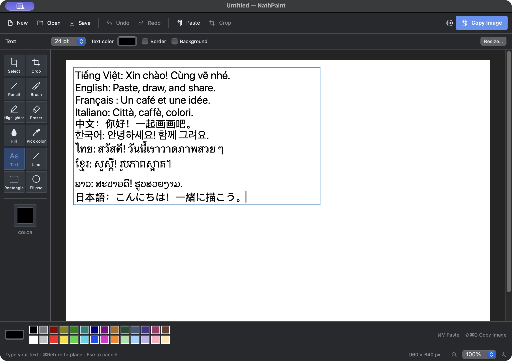
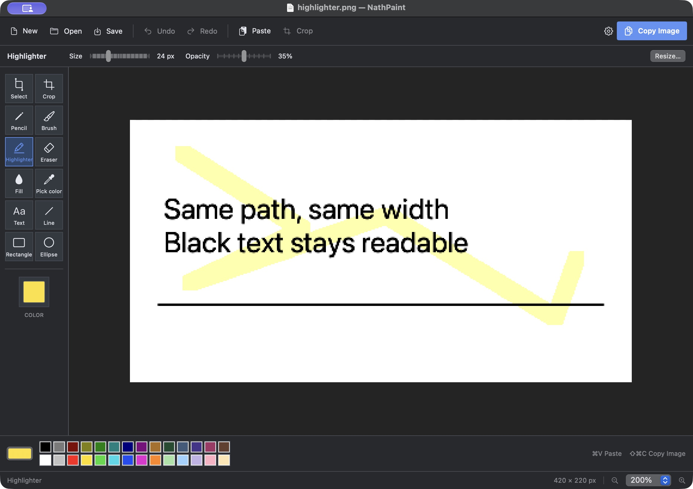
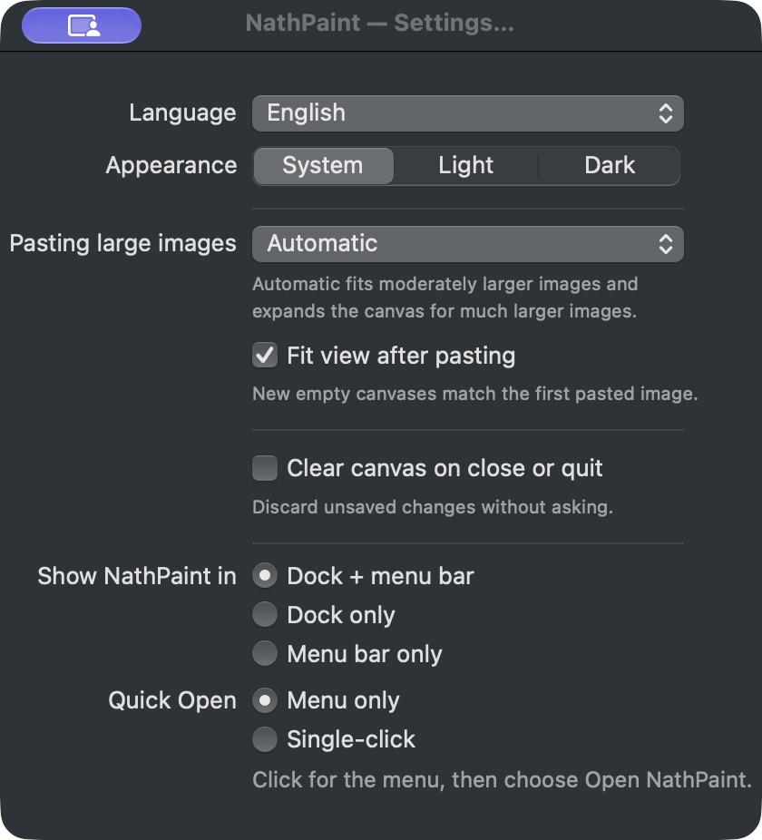

# NahtPaint

A small native macOS paint app inspired by the direct, familiar workflow of Windows XP Paint. SwiftUI supplies the interface; AppKit and Core Graphics handle the pixel canvas, text editing, clipboard and menu bar. No third-party runtime dependencies.



## Download and install

Download **NahtPaint-0.3.0-macOS-universal.zip** from the [latest GitHub Release](https://github.com/VN-Levie/NahtPaint/releases/latest). The app supports **Apple Silicon and Intel Macs running macOS 14 or later**. No Xcode or additional runtime installation is needed.

1. Download the app ZIP under **Assets**, extract it, and drag **NahtPaint.app** into **Applications**. No GitHub account is required.
2. If upgrading from NathPaint, turn off **Launch at login** in the old app if enabled, then quit it and move **NathPaint.app** out of **Applications** before installing **NahtPaint.app**. Existing preferences are preserved; enable Launch at login again in NahtPaint if needed.
3. Open NahtPaint. This build is ad-hoc signed and is not Apple-notarized. If macOS blocks it, use **System Settings → Privacy & Security → Open Anyway** after trying to open the app. See [Apple's instructions](https://support.apple.com/en-au/102445).

## Build and run

Requires macOS 14 or later. Build with Xcode 26 or later (Swift 6 and Icon Composer asset compilation). The package uses Swift 5 language mode.

```sh
./scripts/build-app.sh
open build/NahtPaint.app
```

Open `Package.swift` in Xcode to work on the app. `swift run NahtPaint` starts the process in the menu bar; choose **Open NahtPaint** to show the editor. The bundled `.app` opens the editor on a normal launch and provides the proper Dock icon and Finder integration.

```sh
swift test
```

Build a Universal app for both Apple Silicon and Intel with `./scripts/build-app.sh --universal`.

## Quick workflow

1. Copy an image, open NahtPaint and press **⌘V**. The first paste sizes a new canvas to the image's actual pixels. If the clipboard contains text, **⌘V** creates an editable text box immediately; while editing text, it pastes into that same box.
2. Draw, type, select, move, resize or crop. Paste more images to build a composition.
3. Choose **Copy Image** (**⇧⌘C**) to put the entire result on the clipboard, ready to paste into another app. **⌘C** copies the current selection, or the full image if nothing is selected.

**Ctrl+A** is also supported alongside **⌘A**. **Delete** or **Backspace** removes the canvas selection (undo with ⌘Z); while typing, these keys only affect the text editor.

Use **Return** to place a floating selection and **Escape** to cancel it. Text is edited directly on the canvas; **⌘Return** finishes typing. Ordinary copy/paste shortcuts edit text while its editor has focus. Confirmed text remains a movable, editable foreground object in the open document. Use Select or Text to drag it, or double-click it to edit again. Escape cancels a re-edit. Copying or saving PNG/JPEG composites text without discarding the live text objects.

## Tools and files

- Rectangular selection with drag, corner resizing, horizontal/vertical flip, arrow-key nudging, cut, copy, delete and crop. Use the flip buttons in the toolbar or **Image → Flip Horizontal / Flip Vertical**; selected text remains editable.
- Pencil, brush, highlighter, eraser, flood fill, eyedropper, text, line, rectangle and ellipse. Freehand tools show their actual tip shape and stroke footprint under the pointer, scaled with zoom.
- Pencil uses a crisp square pixel tip; Brush uses a smooth round tip. Pencil, Brush, Eraser and Highlighter remember independent widths (defaults 3, 10, 16 and 24 pixels).
- Highlighter defaults to warm yellow at 35% opacity and uses multiply blending to keep dark raster text readable. A continuous stroke does not darken at joins or self-crossings; a separate stroke can deepen the highlight. Color and opacity are adjustable. Editable text remains in the foreground.
- Tool shortcuts: **P** pencil, **B** brush, **H** highlighter, **E** eraser, **C** crop, **M** select, **T** text, **G** fill, **I** eyedropper, **L** line, **R** rectangle, **O** ellipse. Tool letters are inactive while entering text.
- Crop tool: drag a crop area and press Return to apply; Escape cancels.
- Inline text with independent color, size, optional border and optional background color. The bottom palette changes text color when the Text tool is active.
- Preset and custom colors, brush width, text size, shape fill and zoom.
- Image resizing and canvas sizing through the Image menu.
- Image-file drag and drop, Open, Save and Save As. PNG retains alpha; JPEG composites transparency onto white.
- Bounded undo/redo history. Quit/New/Open prompt for unsaved changes.



The first version edits one document at a time. The raster drawing has editable text objects above it. PNG/JPEG files are flattened images; reopening them cannot recover editable text. There is no editable project file format yet. Changes stay local. By default, closing the window keeps the current document in memory; choose **Quit NahtPaint** to exit. The first launch asks whether to keep that behavior or clear the canvas automatically on close/quit. There is no recovery after a forced termination, so save important work.

## Menu bar and preferences

**Settings** (**⌘,**) controls:

- **Launch at login:** off until enabled. macOS starts NahtPaint in the menu bar without opening the editor or a first-run dialog. Opening the app explicitly restores the saved Dock/menu-bar mode. The toggle reflects the macOS Login Items state and shows an approval action if macOS requires it.
- **Pasting large images:** Automatic, Fit to canvas, or Expand canvas. Automatic fits oversized images if at least half their size can be retained; otherwise it expands the canvas. If expansion would exceed supported image dimensions, it fits instead. New empty canvases always adopt the first image’s physical pixel dimensions.
- **Fit view after pasting:** enabled by default. Fits the entire canvas in the viewport without changing image pixels.
- **Clear canvas on close or quit:** opt-in automatic discard of unsaved canvas contents, including text objects. This never deletes saved files. Disabled by default; a first-run choice explains both behaviors.
- **Show NahtPaint in:** Dock + menu bar, Dock only, or Menu bar only.
- **Quick Open:** Menu only (default: click shows the menu immediately) or Single-click (click opens the editor, right-click shows the menu). Old double-click preferences fall back to Menu only.
- **Appearance:** System (default), Light, or Dark. Only the interface changes; a new canvas stays white and existing image pixels retain their colors.
- **Language:** English (default), Vietnamese, Simplified Chinese, Japanese, or System. System follows the supported preferred macOS language and falls back to English.



Preferences persist across launches. There is no double-click detection or delayed menu. In Dock-only mode the Dock icon reopens the hidden editor.

## Artwork

The app logo was created with the built-in ImageGen tool and packaged as a macOS icon. `Resources/logo-prompt.txt` records the prompts. `Resources/NahtPaint.icon` supplies the native background and foreground layers; the app build compiles it with `actool` for correct large Finder previews. To rebuild the legacy icon sizes:

```sh
./scripts/make-icon.sh
```

## Distribution

`build-app.sh` creates an ad-hoc signed app for the current Mac architecture; pass `--universal` to include both `arm64` and `x86_64`. Before signing, it removes debug-symbol metadata and checks that the executable contains no local user or temporary paths. The release ZIP includes all app resources and the MIT license. It is ad-hoc signed, without a Developer ID signature or Apple notarization, so a new Mac may require the first-open approval described above. The current functional tests ran on Apple Silicon; the Intel build has been compiled and checked but has not been run on an Intel Mac. Build output and local preferences are excluded from Git.

## License

NahtPaint is available under the [MIT License](LICENSE). You may use, modify, and redistribute it, including commercially, provided you retain the copyright and license notice. The software is provided without warranty.
